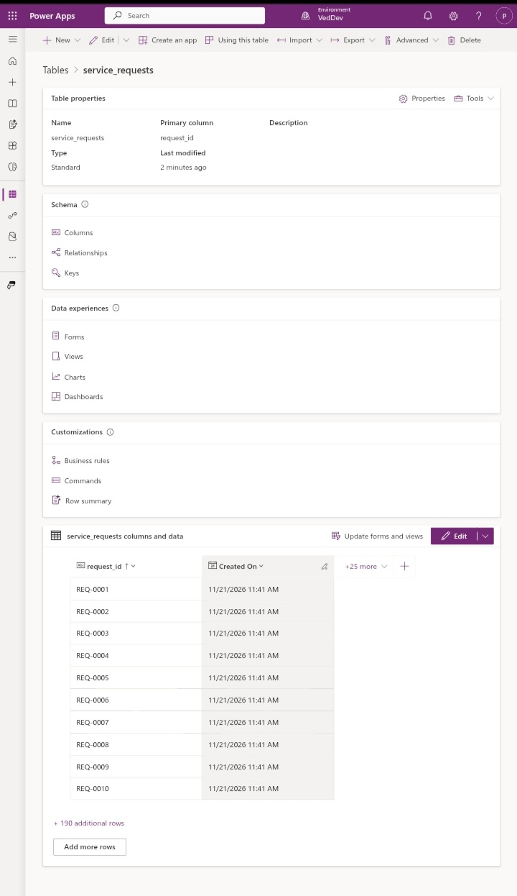
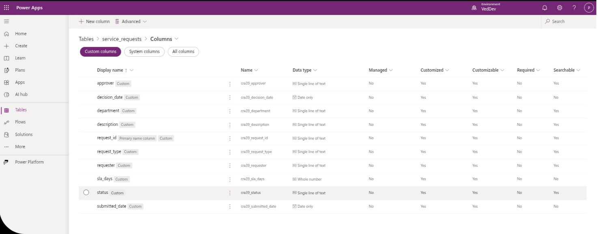
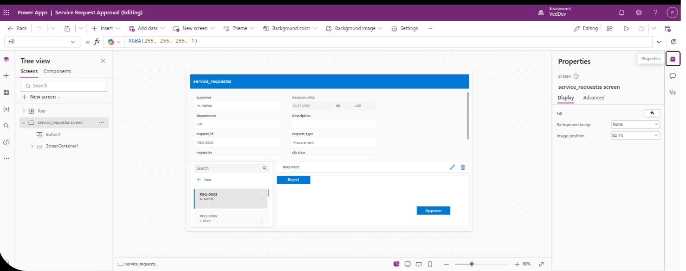
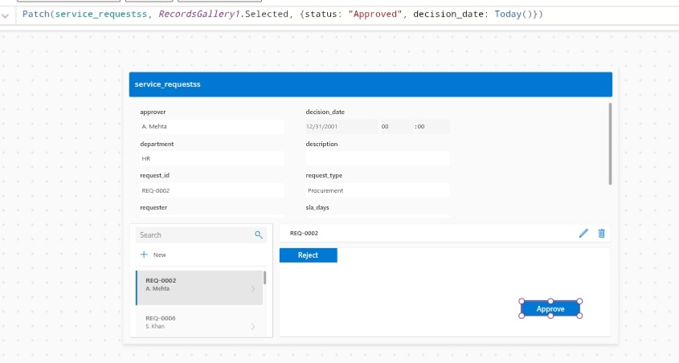
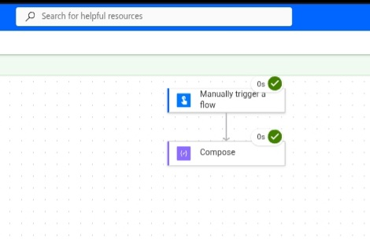
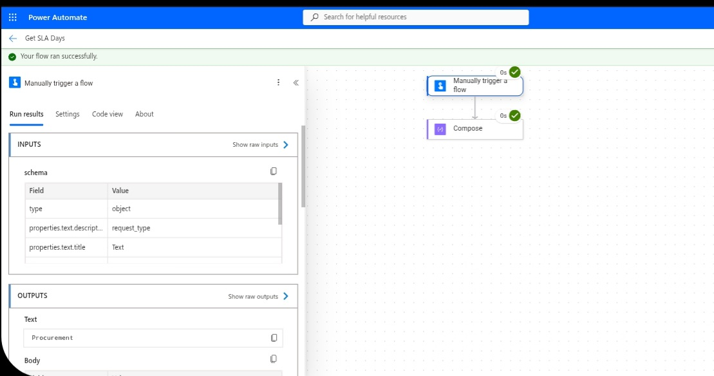
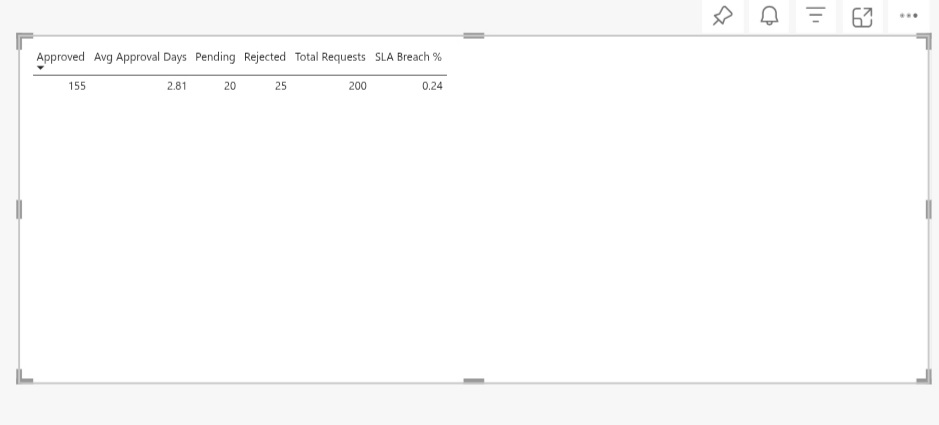
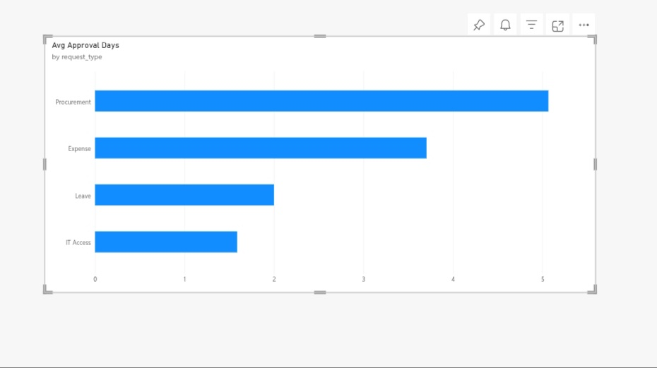

# # Service Request Approval Analysis

A practice project that models one internal approval process across the Microsoft Power Platform, with requirements, testing and a defect log. All data is synthetic.

**Data:** 200 synthetic requests | **Environment:** Power Platform developer environment | **Author:** Shital Parab

## 1. Business problem

Internal requests (IT access, leave, procurement, expense) need manager approval within a fixed SLA. Leadership has no single view of request volume, status, approval time or SLA breaches. This project defines the requirements, builds a workflow and a reporting view, and tests the results.

## 2. Scope

**In scope:** requirements (BRD), process flow, a Dataverse table, a Power Apps canvas app with approve and reject actions, a Power Automate cloud flow, a Power BI report, UAT and a defect log.

**Out of scope:** production deployment, access control, live Dataverse reporting, email notifications, the Approvals connector.

## 3. Solution overview

| Component | Tool | What it does | Evidence |
|---|---|---|---|
| Data store | Microsoft Dataverse | Table of 200 requests (request ID, type, department, requester, approver, submitted date, decision date, status, SLA days, description) | Screenshots 01, 02 |
| Application | Power Apps (canvas app) | Lists requests; Approve and Reject buttons set the status and the decision date | Screenshots 03, 04 |
| Automation | Power Automate (instant cloud flow, standard connectors) | Calculates SLA days from the request type: IT Access 2, Leave 3, Procurement 5, Expense 4 | Screenshots 05, 06 |
| Reporting | Power BI | DAX measures and a report showing six KPIs | Screenshot 07, `powerbi_measures.md` |
| Prototype | HTML web app | The same workflow as a browser prototype, with a dashboard and CSV export | `service-request-approval-web-app.html` |

## 4. Requirements coverage

| ID | Requirement | Coverage |
|---|---|---|
| BR-01 | Request counts by status | Covered in Power BI |
| BR-02 | Average approval time | Covered in Power BI |
| BR-03 | SLA breach count and percentage | Percentage covered in Power BI; count not tested |
| BR-04 | Breakdown by type and department | Web app prototype only; not tested in Power BI |
| BR-05 | Filters | Web app prototype only; not tested in Power BI |
| BR-06 | Executive summary | See the project pack in `docs/` |

## 5. Results (UAT)

| Measure | Expected | Actual | Result |
|---|---|---|---|
| Total requests | 200 | 200 | Pass |
| Approved | 155 | 155 | Pass |
| Rejected | 25 | 25 | Pass |
| Pending | 20 | 20 | Pass |
| Average approval days | 2.81 | 2.81 | Pass |
| SLA breach % | 23.9% | 0.24 (23.9% rounded to two decimals) | Pass |

Four tests were not run (SLA breach count, Procurement average from a bar chart, sum by type, status filter). Full detail: [`docs/UAT_Results_and_Defect_Log.md`](docs/UAT_Results_and_Defect_Log.md).

## 6. Issues and workarounds

| Issue | Workaround |
|---|---|
| A Dataverse system Status column clashed with the imported status column | Used the imported lowercase column |
| File upload was blocked by a missing OneDrive license | Loaded the data by another supported route |
| The Approvals connector was blocked by the tenant data policy | Built the flow without it |
| The Dataverse connector is premium in Power Automate | Built an instant cloud flow with standard connectors |
| The Power Apps AI app builder was unavailable | Built the canvas app by hand |

## 7. Limitations

- All data is synthetic. Not for production use.
- Built in a developer environment, with preview features that may change.
- The Power BI report was built from the CSV, not live from Dataverse.
- The Power Automate flow that ran uses a manual trigger. A Dataverse-triggered flow was not run.
- No slicer or cross-filter was built.

## 8. Repository contents

```
README.md
service_requests.csv
service-request-approval-web-app.html
powerbi_measures.md
docs/
  Service_Request_Project_Pack.pdf
  UAT_Results_and_Defect_Log.md
screenshots/
  01-dataverse-table-200-rows.png
  02-dataverse-column-types.png
  03-canvas-app-approve-reject.png
  04-approve-button-formula.png
  05-power-automate-flow.png
  06-power-automate-run-succeeded.png
  07-power-bi-report.png
  08-power-bi-report.png
```

## 9. Screenshots

**Dataverse table (200 rows)**


**Column types**


**Canvas app with Approve and Reject buttons**


**Approve button formula**


**Power Automate flow**


**Successful flow run**


**Power BI report**


**Power BI report**


## 10. How to reproduce

1. Import `service_requests.csv` into a Dataverse table and set the date columns to Date and `sla_days` to a whole number.
2. Build a canvas app on the table with Approve and Reject buttons that update the status and the decision date.
3. Build an instant cloud flow with a text input and a Compose action that returns the SLA days for the request type.
4. Load the CSV into Power BI and add the measures from `powerbi_measures.md`.
5. Compare the report with the expected values in the UAT log.

## Author

Shital Parab | Mumbai, India | github.com/Shital24650
